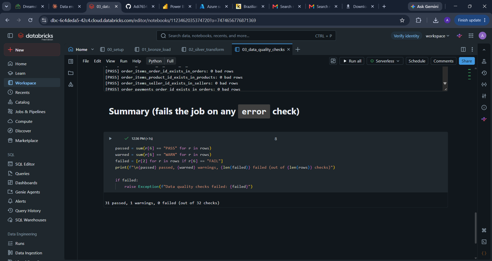
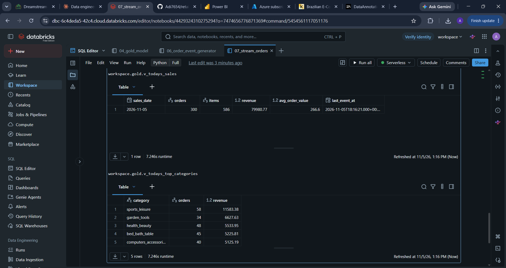
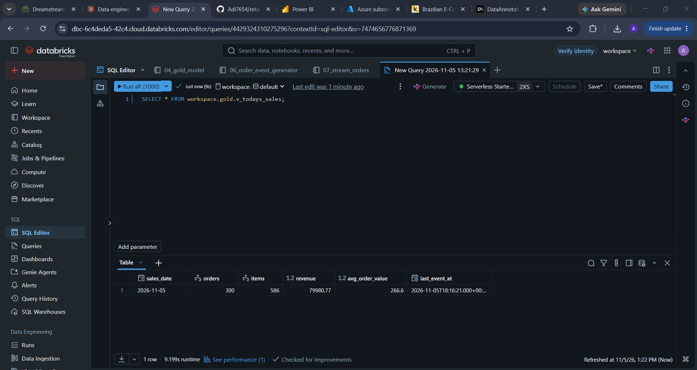

# Retail Sales Lakehouse on Databricks

An end-to-end data engineering project that builds a **medallion-architecture Lakehouse** (bronze → silver → gold) on **Databricks** with **Delta Lake** and **Unity Catalog**, using the Olist Brazilian e-commerce dataset. It includes incremental loads with Delta MERGE, a star-schema model with SCD Type 2 dimensions, streaming ingestion, automated data quality checks, and a Power BI report.

> 🚧 Status: in active development. Sections marked _TODO_ are filled in as each layer is completed.

---

## Architecture


```
Raw CSVs ──► Unity Catalog Volume (landing zone)
                    │  01_bronze_load: raw ingest + audit columns
                    ▼
             workspace.bronze.*   (raw Delta tables)
                    │  02_silver_transform: types, dedup, data quality checks
                    ▼
             workspace.silver.*   (clean Delta tables)
                    │  03_gold_model: Delta MERGE, SCD Type 2, star schema
                    ▼
             workspace.gold.*     (fact + dimensions) ──► Power BI (Databricks SQL)

New order files ──► Auto Loader / Structured Streaming ──► streaming orders table

Orchestration: Databricks Workflow (bronze → silver → gold task chain)
```

## Tech Stack

| Area | Tools |
|------|-------|
| Platform | Databricks (Free Edition, serverless compute) |
| Storage and governance | Delta Lake, Unity Catalog (catalog, schemas, Volumes) |
| Processing | PySpark, Spark SQL |
| Modeling | Star schema, SCD Type 2, Delta MERGE incremental loads |
| Streaming | Auto Loader, Structured Streaming |
| Orchestration | Databricks Workflows (Jobs) |
| Serving | Databricks SQL warehouse, Power BI Desktop |
| Version control | Git / GitHub |

## Dataset

[Brazilian E-Commerce Public Dataset by Olist](https://www.kaggle.com/datasets/olistbr/brazilian-ecommerce): about 100K orders (2016–2018) across 9 CSV files: customers, geolocation, orders, order items, payments, reviews, products, sellers, and a category translation lookup.

## Layers

### Bronze: raw ingestion
- Raw CSVs land in a Unity Catalog Volume: `/Volumes/workspace/bronze/landing/olist/<load_date>/`.
- `01_bronze_load` picks the latest load folder automatically and writes each file to a `workspace.bronze.*` Delta table, kept as strings.
- Audit columns: `_ingested_at`, `_source_file` (from `_metadata.file_path`), `_load_date`.
- **Rows ingested:** ~1.55M across 9 tables


### Silver: cleaned and validated
- `02_silver_transform` casts types with `try_cast` (bad values become NULL instead of failing), standardizes text, pads zip codes, fixes source column typos, and removes duplicates per business key.
- Every row gets a `_row_hash`. Tables are written with **Delta MERGE** (insert new, update changed, delete removed), so only rows that actually changed get a new `_processed_at`.
- `03_data_quality_checks` runs **32 automated checks** (completeness, primary keys, referential integrity, value ranges, valid statuses) and logs every result to `silver.dq_results`. `error` checks stop the Workflow; `warn` checks are logged only.



### Gold: star schema
`04_gold_model` builds the reporting layer:

| Table | Grain / type | Load method |
|---|---|---|
| `fact_sales` | 1 row per order item | MERGE upsert on `(order_id, order_item_id)` |
| `dim_customer` | **SCD Type 2** | MERGE that expires the old version and inserts the new one |
| `dim_product`, `dim_seller` | SCD Type 1 | MERGE upsert |
| `dim_date` | Calendar | Rebuilt each run |
| `load_log` | Run history | Mode, duration, watermark, rows processed |

**Incremental mode** reads only silver rows whose `_processed_at` is newer than the last successful run's watermark.

**SCD Type 2** keeps customer address history. The source is staged twice in one atomic MERGE: rows keyed by `customer_id` expire the current version, and changed rows with a NULL key are inserted as the new version.


### Testing incremental loads
Olist is a one-time snapshot, so `05_simulate_new_batch` creates a realistic next-day batch: **500 customers move**, **1,000 new orders** (half from customers who moved), and **300 shipped orders become delivered**. The full pipeline then runs incrementally.

### Streaming: Auto Loader
Simulates a live order feed and ingests it incrementally:

- `06_order_event_generator` drops JSON order-event files into a landing Volume (5 files and ~300 events per run, using real customer, product and seller IDs). About **2% of events are re-sent** with the same `event_id`, like a real at-least-once feed.
- `07_stream_orders` uses **Auto Loader** (`cloudFiles`) with an explicit schema to stream new files into `bronze.order_events`:
  - a **checkpoint** records which files have been read, so each run processes **only new files, exactly once**
  - `dropDuplicatesWithinWatermark(["event_id"])` removes re-sent events (1-hour watermark)
  - `trigger(availableNow=True)` processes everything new and then stops, the standard pattern for streams inside a scheduled job
- Three **gold views** serve "today's sales": `v_todays_sales` (orders, items, revenue, average order value), `v_todays_sales_by_hour`, and `v_todays_top_categories` (joined to `dim_product`).

| Run | Behaviour |
|---|---|
| 1st | New files ingested, duplicates dropped |
| 2nd (after new files arrive) | **Only the new files** are read; earlier files are skipped via the checkpoint |
| Re-run with no new files | **0 events read**, no duplicates created |





### Power BI
_TODO: report screenshots_

## Orchestration

`retail_lakehouse_pipeline` is a Databricks Workflow that runs the notebooks as dependent tasks:

```
bronze_load ──► silver_transform ──► dq_checks ──► gold_model ──► stream_orders
```


## Design Decisions

- **Medallion architecture with separate schemas** (`bronze`, `silver`, `gold`): clear lineage and ownership, easy to explain and govern in Unity Catalog.
- **Bronze kept as raw strings:** no data loss at ingestion; all typing and cleaning happens in silver, so bronze can always be replayed.
- **Date-partitioned landing folders:** each load is traceable, and the pipeline automatically picks the latest one.
- **`_metadata.file_path` for lineage:** the Unity Catalog-compatible replacement for `input_file_name()`.
- **Row hashes + watermark:** cheap change detection. Silver only stamps rows that really changed, and gold processes just those.
- **Quality gate before gold:** `error` checks fail the Workflow, so bad data never reaches reporting tables.
- **Fact rows keep their original `customer_key` on update:** historical sales stay linked to the customer version that was current when they were loaded.
- **Full mode resets SCD2 history:** it rebuilds `dim_customer` from current data, which is why incremental is the default.
- **Explicit schema for the stream:** types are enforced on read instead of inferred, so a malformed file can't silently change the table's schema.
- **`availableNow` trigger:** serverless compute doesn't support always-on streams, and batch-style streaming inside a job is cheaper anyway; latency equals the job schedule.

## Results

| Metric | Value |
|--------|-------|
| Total records ingested (bronze) | ~1.55M across 9 tables |
| Fact rows processed: full load | 112,650 (24.4s) |
| Fact rows processed: incremental load | **1,484** (23.4s), **~99% less data** |
| Customer rows processed: incremental | 500 (all moved customers, history kept) |
| Automated data quality checks | 32 |

**Why runtime barely changed:** at ~100K rows, fixed overhead (serverless job startup, rebuilding `dim_date`, MERGE scanning the target) dominates. Full reloads grow with *total* data volume; incremental loads grow only with the *changes*, so the gap widens as data grows.

## Repository Structure

```
├── data/raw/      # source CSVs
├── notebooks/     # exported Databricks notebooks (.ipynb)
├── pipelines/     # Workflow (job) definitions and screenshots
└── docs/          # architecture diagram, screenshots
```

## How to Run

1. Create a [Databricks Free Edition](https://www.databricks.com/learn/free-edition) workspace.
2. Run `00_setup` to create the `bronze`, `silver` and `gold` schemas and the landing Volume.
3. Upload the CSVs from `data/raw/` to the landing Volume folder printed by `00_setup`.
4. Import the notebooks from `notebooks/` and run them in order (`01` → `04`). The first `04_gold_model` run does a full load automatically.
5. To test incremental loading: run `05_simulate_new_batch`, then the `retail_lakehouse_pipeline` Workflow.
6. To test streaming: run `06_order_event_generator`, then `07_stream_orders` (repeat to see only new files picked up).

## Author

**Aditya Raj**: [LinkedIn](https://linkedin.com/in/aditya-raj-5a1a6a21b)
