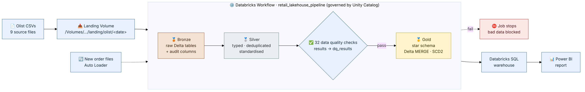

# Retail Sales Lakehouse on Databricks

An end-to-end data engineering project that builds a **medallion-architecture Lakehouse** (bronze → silver → gold) on **Databricks** with **Delta Lake** and **Unity Catalog**, using the Olist Brazilian e-commerce dataset. It includes incremental loads with Delta MERGE, a star-schema model with SCD Type 2 dimensions, streaming ingestion, automated data quality checks, and a Power BI report.

> 🚧 Status: in active development. Sections marked _TODO_ are filled in as each layer is completed.

---

## Architecture



```
Raw CSVs ──► Unity Catalog Volume (landing zone)
                    │  01_bronze_load: raw ingest + audit columns
                    ▼
             workspace.bronze.*   (raw Delta tables)
                    │  02_silver_transform: types, dedup, data quality checks
                    ▼
             workspace.silver.*   (clean Delta tables)
                    │  03_gold_model: Delta MERGE, SCD Type 2, star schema
                    ▼
             workspace.gold.*     (fact + dimensions) ──► Power BI (Databricks SQL)

New order files ──► Auto Loader / Structured Streaming ──► streaming orders table

Orchestration: Databricks Workflow (bronze → silver → gold task chain)
```

## Tech Stack

| Area | Tools |
|------|-------|
| Platform | Databricks (Free Edition, serverless compute) |
| Storage and governance | Delta Lake, Unity Catalog (catalog, schemas, Volumes) |
| Processing | PySpark, Spark SQL |
| Modeling | Star schema, SCD Type 2, Delta MERGE incremental loads |
| Streaming | Auto Loader, Structured Streaming |
| Orchestration | Databricks Workflows (Jobs) |
| Serving | Databricks SQL warehouse, Power BI Desktop |
| Version control | Git / GitHub |

## Dataset

[Brazilian E-Commerce Public Dataset by Olist](https://www.kaggle.com/datasets/olistbr/brazilian-ecommerce): about 100K orders (2016–2018) across 9 CSV files: customers, geolocation, orders, order items, payments, reviews, products, sellers, and a category translation lookup.

## Layers

### Bronze: raw ingestion
- Raw CSVs land in a Unity Catalog Volume: `/Volumes/workspace/bronze/landing/olist/<load_date>/`.
- `01_bronze_load` picks the latest load folder automatically and writes each file to a `workspace.bronze.*` Delta table, kept as strings.
- Audit columns: `_ingested_at`, `_source_file` (from `_metadata.file_path`), `_load_date`.
- **Rows ingested:** _TODO_

### Silver: cleaned and validated
_TODO: type casting, deduplication, null handling, data quality checks_

### Gold: star schema
_TODO: fact_sales, dim_customer (SCD2), dim_product, dim_seller, dim_date; Delta MERGE incremental logic_

### Streaming
_TODO: Auto Loader ingestion of new order files_

### Power BI
_TODO: report screenshots_

## Orchestration

`retail_lakehouse_pipeline` is a Databricks Workflow that runs the notebooks as dependent tasks:

```
bronze_load ──► silver_transform ──► gold_model
```

_TODO: add a screenshot of a successful run._

## Design Decisions

- **Medallion architecture with separate schemas** (`bronze`, `silver`, `gold`): clear lineage and ownership, easy to explain and govern in Unity Catalog.
- **Bronze kept as raw strings:** no data loss at ingestion; all typing and cleaning happens in silver, so bronze can always be replayed.
- **Date-partitioned landing folders:** each load is traceable, and the pipeline automatically picks the latest one.
- **`_metadata.file_path` for lineage:** the Unity Catalog-compatible replacement for `input_file_name()`.
- _TODO: add more as built_

## Results

| Metric | Value |
|--------|-------|
| Total records processed | _TODO_ |
| Incremental vs full reload runtime | _TODO_ |
| Automated data quality checks | _TODO_ |

## Repository Structure

```
├── data/raw/      # source CSVs
├── notebooks/     # exported Databricks notebooks (.ipynb)
├── pipelines/     # Workflow (job) definitions and screenshots
└── docs/          # architecture diagram, screenshots
```

## How to Run

1. Create a [Databricks Free Edition](https://www.databricks.com/learn/free-edition) workspace.
2. Run `00_setup` to create the `bronze`, `silver` and `gold` schemas and the landing Volume.
3. Upload the CSVs from `data/raw/` to the landing Volume folder printed by `00_setup`.
4. Import the notebooks from `notebooks/` and run the `retail_lakehouse_pipeline` Workflow (or the notebooks in order).

## Author

**Aditya Raj**: [LinkedIn](https://linkedin.com/in/aditya-raj-5a1a6a21b)
